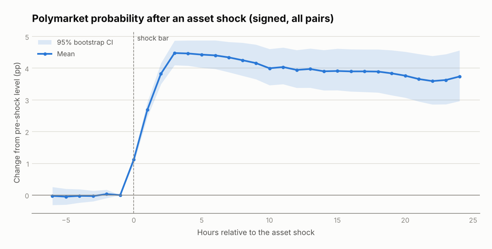
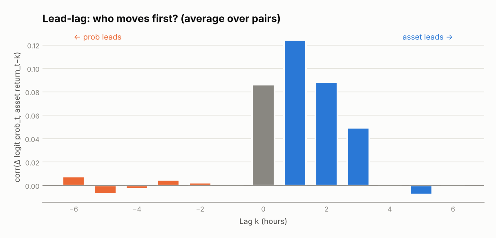
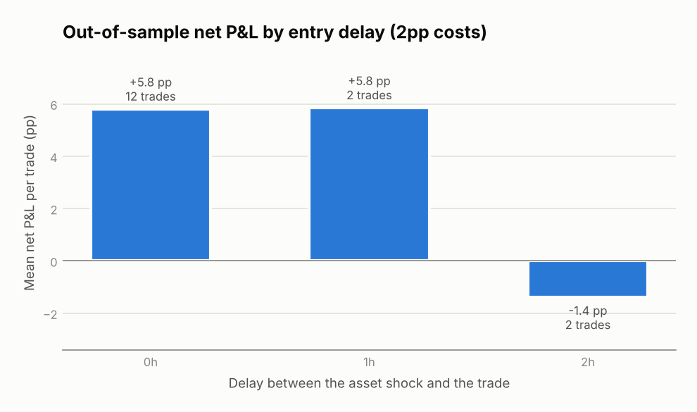

# Do Prediction Markets Lag Traditional Assets?

An event study of **Polymarket** probabilities around shocks in correlated traditional assets (e.g. crude oil vs. Middle East escalation odds). The hypothesis: professional traders move the asset first, and the retail-heavy prediction market catches up over the following hours. If the lag is real and larger than trading costs, it is tradable.

The project measures the lag instead of assuming it: it tests the lead-lag in both directions, quantifies how much of the probability move happens after the shock, and checks whether a cost-aware trading rule survives out-of-sample and with execution delay.



## Method

1. **Data.** Polymarket Yes-token price history (public CLOB API) and hourly bars for the asset (Yahoo Finance). The probability is aligned to each asset bar using the **last print at or before** that bar, so both prices are observed at the same moment.
2. **Asset shocks.** An hourly return beyond 3× its trailing volatility (estimated from past bars only), at least 0.5%, with a 12-hour cooldown so one news cluster counts once.
3. **Event study.** For every shock, the probability path from 6 hours before to 24 hours after, signed by the expected direction (e.g. oil up → escalation odds up). Averaged across events with a 95% bootstrap band. Key outputs: the share of the move that happens on the shock bar, the half-life of the adjustment, and the post-shock drift a trader could still capture.
4. **Lead-lag.** Cross-correlations of probability changes (in log-odds) with asset returns at lags −6…+6 hours, and regressions in **both directions** with heteroskedasticity-robust (HC1) t-stats: do past asset returns predict probability changes, and vice versa?
5. **Sensitivity.** How many log-odds the probability moves per 1% asset move, fitted only on the first half of each pair's events. This gives the **implied probability** after a new shock.
6. **Trading test.** After a shock, if |implied − market probability| > 5pp, buy the lagging contract (Yes or No) and sell 6 hours later, net of a 2pp round-trip cost (spread + fees). Run out-of-sample and with 0, 1 and 2 hours of execution delay, since a lag only pays if you are faster than it.

Probabilities are modeled in **log-odds**, not raw points: a 5pp move from 50% is far smaller news than a 5pp move from 3%.

## Results

### Validation on synthetic markets with a known lag

`pmes.synthetic` builds three asset/market pairs where the probability responds to asset returns spread over the shock hour and the next three hours (25% / 35% / 25% / 15%), plus independent news and noise. The analysis should recover the lag, its direction and the sensitivities:

| Check | Truth | Recovered |
|---|---|---|
| Sensitivity β (three pairs) | 15 / −12 / 10 | 13.3 / −10.6 / 10.6 |
| Share of the move on the shock bar | 25% | 25% |
| Lead-lag peak | asset leads by 1h | corr at +1h = 0.12, reverse direction ≈ 0 |
| Out-of-sample trades, no delay | profitable | +5.8pp per trade net, 12 trades |
| Out-of-sample trades, 2h delay | lag mostly gone | −1.4pp per trade |

The tests also run a control market with **no** lag, where the analysis must find the move complete on the shock bar and the trading rule must rarely fire.

These numbers validate the code, not a market claim. Full report: [`reports/synthetic/summary.md`](reports/synthetic/summary.md).





### Real Polymarket data

Run on real pairs (below); the report is written to `reports/summary.md`.

## Quick start

```bash
git clone https://github.com/carol-747/prediction-market-event-study
cd prediction-market-event-study
pip install -e ".[dev]"

# 1) Validate on synthetic markets
python -m pmes.pipeline --synthetic
pytest

# 2) Real data: find markets and their Yes-token ids
python -m pmes.polymarket search "Iran"
mkdir -p data && cp pairs/example.csv data/pairs.csv   # paste token ids, pick assets and dates
python -m pmes.pipeline
```

`pairs.csv` columns: `name`, `token_id` (Yes token), `asset` (Yahoo ticker, e.g. `CL=F` crude oil, `ZN=F` 10-year Treasury futures), `sign` (+1 if the probability should rise when the asset rises), `start`, `end`.

## Project structure

```
src/pmes/
  polymarket.py  market search and price history (public APIs, no key)
  data.py        hourly asset bars, alignment, log-odds
  analysis.py    shocks, event paths, bootstrap bands, lead-lag, sensitivity
  strategy.py    trade-the-lag rule with costs and execution delay
  synthetic.py   markets with a known lag for validation
  pipeline.py    end-to-end run and report
tests/           ground-truth tests incl. a no-lag control
```

## Limitations

- **Thin markets.** Polymarket prints can be sparse; a stale last price can look like a lag. Check volume around events and treat illiquid markets with care.
- **Execution.** Costs are a flat 2pp round trip. Real fills depend on order-book depth; a large order moves the price.
- **Hourly resolution.** Lags shorter than an hour show up as "on the shock bar". Minute data would sharpen the estimate.
- **Few events.** A single market may have only dozens of shocks, so out-of-sample statistics are noisy; pooling pairs helps.
- **Yahoo hourly data** only goes back about two years.
