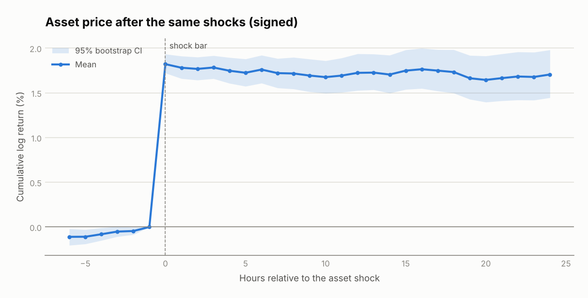

# Results summary

Shocks: asset hourly return beyond 3× trailing volatility, 12h cooldown. Events: **287**.

## Pairs

| Pair | Bars | Shocks | Calibration events | Fitted β (logit / log-return) | True β |
|---|---|---|---|---|---|
| escalation_vs_oil | 7999 | 90 | 45 | 13.29 | 15.0 |
| ceasefire_vs_oil | 7999 | 100 | 50 | -10.56 | -12.0 |
| rate_cut_vs_bonds | 7999 | 99 | 49 | 10.61 | 10.0 |

## How fast does Polymarket adjust?

- Signed probability move on the shock bar: **1.12 pp**
- Move after 6h: **4.40 pp**
- Share of the 6h move already done on the shock bar: **25%**
- Bars until half the move is done: **1**
- Post-shock drift (the part a trader could still capture): **3.28 pp**

Mean signed path (pp): +0h 1.12, +1h 2.69, +2h 3.83, +3h 4.48, +4h 4.46, +5h 4.43, +6h 4.40

## Lead-lag regressions (HC1 t-stats, first pair shown)

**prob_on_asset** (escalation_vs_oil)

| Term | Coef | t |
|---|---|---|
| const | 0.0001 | 0.27 |
| r_lag0 | 3.6959 | 38.02 |
| r_lag1 | 5.1573 | 47.35 |
| r_lag2 | 3.5957 | 36.21 |
| r_lag3 | 2.1594 | 22.68 |
| dx_lag1 | 0.0146 | 1.62 |

**asset_on_prob** (escalation_vs_oil)

| Term | Coef | t |
|---|---|---|
| const | -0.0000 | -0.53 |
| dx_lag0 | 0.0333 | 9.72 |
| dx_lag1 | -0.0057 | -4.41 |
| dx_lag2 | -0.0036 | -3.31 |
| dx_lag3 | -0.0011 | -1.16 |
| r_lag1 | -0.1513 | -8.11 |

Cross-correlation corr(Δlogit_t, r_t−k), averaged over pairs (k > 0: asset leads): k=-6: +0.007, k=-5: -0.007, k=-4: -0.003, k=-3: +0.005, k=-2: +0.002, k=-1: +0.002, k=0: +0.086, k=1: +0.124, k=2: +0.088, k=3: +0.049, k=4: -0.000, k=5: -0.007, k=6: +0.000

## Trading test (buy the lagging contract)

Enter when |implied − market| > 5pp, hold 6h, 2pp round-trip cost. Sensitivity fitted on the first 50% of each pair's events.

| Delay | Sample | Trades | Hit rate | Mean P&L (pp) | t-stat | Mean return |
|---|---|---|---|---|---|---|
| 0h | in-sample | 21 | 90% | 4.70 | 5.18 | 10.0% |
| 0h | out-of-sample | 12 | 100% | 5.80 | 5.65 | 10.7% |
| 1h | in-sample | 5 | 80% | 2.66 | 1.42 | 5.6% |
| 1h | out-of-sample | 2 | 100% | 5.85 | 2.13 | 11.0% |
| 2h | in-sample | 2 | 0% | -3.35 | -1.63 | -5.3% |
| 2h | out-of-sample | 2 | 50% | -1.40 | -0.70 | -1.8% |

